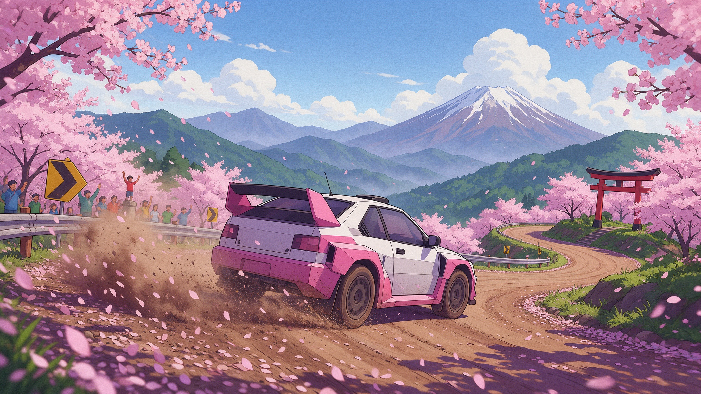
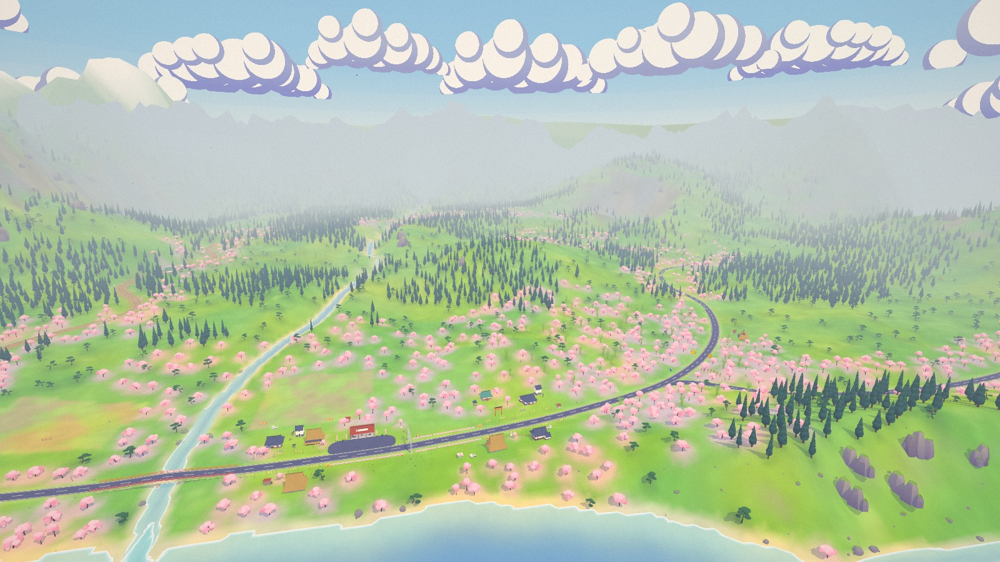
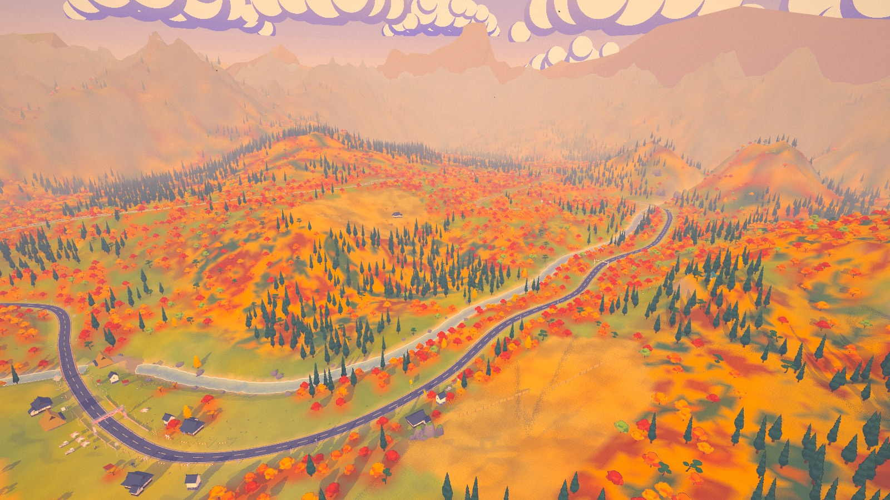
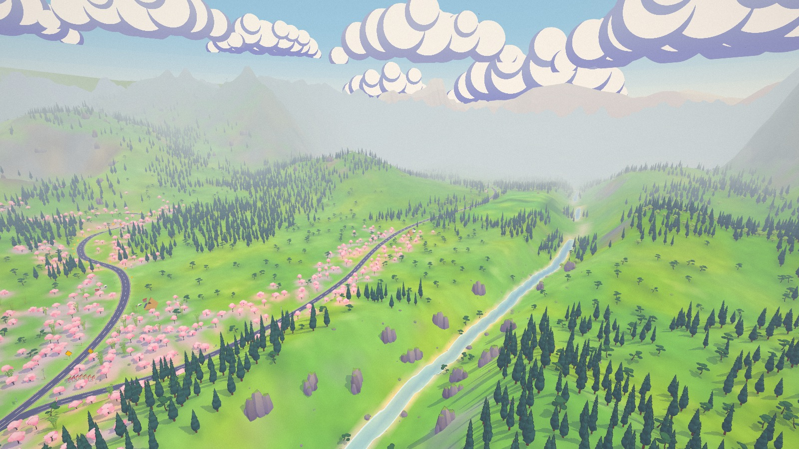

# Sakura Rally 桜ラリー

A cel-shaded low-poly rally game for Summer Engine and Godot 4.7: two stages joined by a road
through the seasons, in one world drawn like an anime background. Flat cel bands, shadows
tinted violet instead of darkened, thin ink lines, painted clouds and aerial haze.

## What's inside

- **One open world, no loading**: Hanami Pass in spring and Momiji Valley in autumn, joined by
  2 km of road through rice paddies and a summer festival village. Seasons blend along the way.
- **Three ways to play**: the Seasons Rally campaign and Time Attack (Time Trial, a 2-lap Race
  against six rivals, Free Roam), with medals and saved records.
- **Custom car physics** on Jolt at 120 Hz: suspension, a combined-slip tyre model per surface,
  6-speed gearbox, turbo, AWD or RWD, and forgiving arcade crashes.
- **Two cars and five liveries** in a roadside garage: Sakura (2.0 turbo AWD) and Hayate
  (1.6 twin-cam RWD coupe).
- **A trained AI driver** that races the rivals, can drive your car, and shows ghost runs.
- **Synthesised engine audio**, soft roadside props that break, spectators that tumble, and a
  replay recorder for every drive.





## Get started

1. Download this repo as a [ZIP](https://github.com/SummerEngine/sakura-rally/archive/refs/heads/main.zip) or clone it.
2. Open the folder in [Summer Engine](https://www.summerengine.com/download), or run
   `npx -y summer-engine@latest run .`
3. Press Play.

Stock Godot 4.7 runs it too: `godot --path .`. On macOS, `Play Sakura Rally.command` starts the
game directly with Summer, or with Godot when Summer is not installed.

Summer's AI agent can extend the game for you. Try:

- "Add a night stage with headlights and lanterns along the road."
- "Add a third car: a light front-wheel-drive hatchback that is easy to throw into corners."
- "Add a rain mode that makes tarmac slippery and adds spray behind the cars."

## Controls

| Action | Keyboard | Gamepad |
|---|---|---|
| Throttle | W / ↑ | RT |
| Brake; hold at a standstill to reverse | S / ↓ | LT |
| Steer | A, D / ←, → | left stick |
| Handbrake | Space | A |
| Shift up / down (manual gearbox) | E / Q | RB / LB |
| Camera: chase, far chase, hood, bumper | C | Y |
| Put the car back on the road | R | Back |
| Pause | Esc / P | Start |
| Horn | H | L3 |
| Hide the UI for screenshots | F1 | |
| AI drives your car / AI ghost cars / watch a ghost ([docs/RL.md](docs/RL.md)) | I / G / V | |

During the countdown the car is held on the line. Hold the throttle: launch control keeps the
engine at 4600 rpm, and at GO the clutch drops into first.

## Modes and maps

- **Campaign, The Seasons Rally**: one continuous drive. SS1 is Hanami Pass; at the finish a
  road sign points on to SS2, the barrier opens, and you drive the untimed road from the sakura
  through summer into the autumn maples. At Momiji Valley's grid the start card waits for SS2.
  The finale is a rally classification against six rivals. Quit at any point and the title
  offers "Continue" at that leg.
- **Time Attack**:
  - **Time Trial**: one lap through checkpoints, with splits against your best, a medal and a
    saved record.
  - **Race**: two laps against the six rivals, each driven by the trained AI at their campaign
    pace. You start last on a staggered grid. No record, no medal.
  - **Free Roam**: no timer and every barrier open. R puts you back on the nearest road.

| Stage | Setting | Gold / Silver / Bronze |
|---|---|---|
| Hanami Pass 花見峠 | spring noon, tarmac and gravel under the blossom | 2:04.5 / 2:18.0 / 2:41.0 |
| Momiji Valley 紅葉谷 | autumn golden hour, loose dirt through the maples | 1:49.5 / 2:01.5 / 2:21.5 |

| Car | Drivetrain | Character |
|---|---|---|
| Sakura 桜 | 2.0 turbo, AWD, 0–100 km/h 3.5 s | grips, forgives, flies |
| Hayate 疾風 | 1.6 twin-cam, RWD, 0–100 km/h 5.0 s, pop-up headlights | rev-happy coupe that slides when you ask it to |

Settings cover quality (low / medium / high), automatic or manual gearbox, camera, km/h or
mph, three volume sliders and fullscreen.

## How it is built

| Part | Source | Docs |
|---|---|---|
| Cars | `tools/blender/build_car.py`, `build_car_hayate.py` → `assets/models/car/` | |
| Physics | `scripts/vehicle/` | [docs/PHYSICS.md](docs/PHYSICS.md) |
| Cameras | `scripts/camera/` | |
| Look | `shaders/`, `scripts/fx/` | |
| World | `tools/mapgen/` → `assets/maps/world/`, `scripts/world/` | [docs/WORLD.md](docs/WORLD.md) |
| Audio | `tools/audio/` | [docs/AUDIO.md](docs/AUDIO.md) |
| UI | `scripts/ui/` | [docs/UI.md](docs/UI.md) |
| Replays | `scripts/autoload/replays.gd`, `tools/replay/` | [docs/REPLAYS.md](docs/REPLAYS.md) |
| AI driver | `scripts/ai/`, `tools/rl/` | [docs/RL.md](docs/RL.md) |

Shared conventions and the runtime APIs: [docs/CONTRACTS.md](docs/CONTRACTS.md). Rebuild commands:

```sh
G=/Applications/Godot.app/Contents/MacOS/Godot
/Applications/Blender.app/Contents/MacOS/Blender --background --factory-startup --python tools/blender/build_car.py
uv run --with numpy --with pillow python tools/mapgen/mapgen.py
timeout 180 $G --headless --disable-crash-handler --path . --import   # after changing raw assets
```

The physics suite, race AI probes and their latest results are in
[docs/PHYSICS.md](docs/PHYSICS.md) and [docs/RL.md](docs/RL.md). The trailer is rendered offline
from the game itself by `tools/video/render_demo.sh`.

## License

Code and assets are MIT, see [LICENSE](LICENSE), except the fonts (Dela Gothic One, Yuji Syuku,
Zen Maru Gothic), which are under the SIL Open Font License 1.1; the licence texts are in
`assets/fonts/`. The music and the ambience beds come from ElevenLabs models on fal;
[docs/AUDIO.md](docs/AUDIO.md) lists the prompts and the provider terms.
